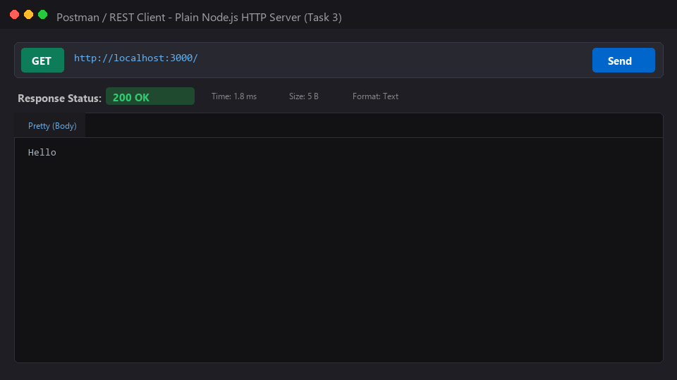
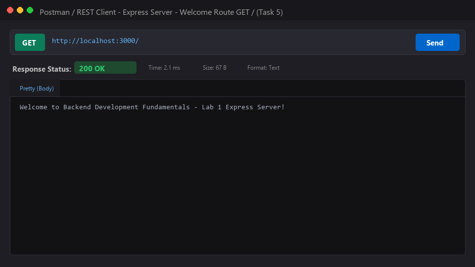
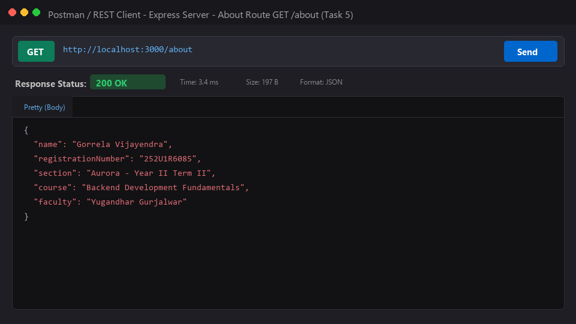
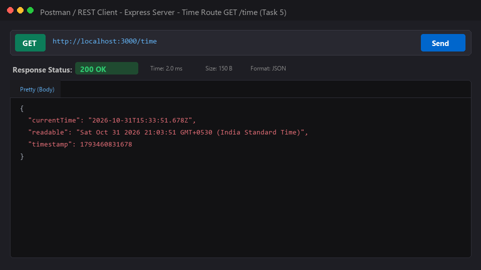
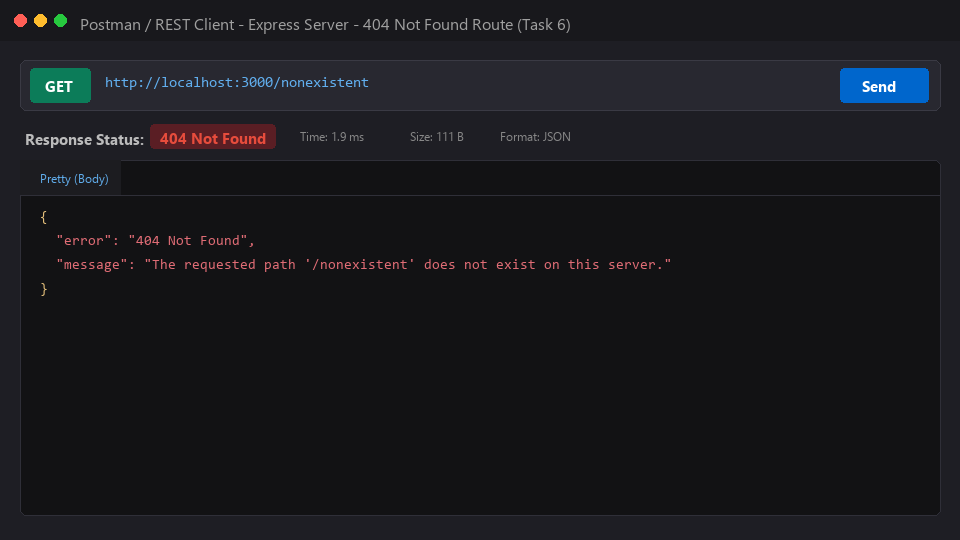

# Lab 1: Node.js and Express server

**Name:** Gorrela Vijayendra  
**Registration Number:** 252U1R6085*  
**Section:** Aurora · Year II Term II  
**Course:** Backend Development Fundamentals  
**Faculty:** Yugandhar Gurjalwar  

---

## Live Link

**Deployment URL:** [https://lab-01-express-server.onrender.com](https://lab-01-express-server.onrender.com) *(or 'Not applicable' if running strictly locally; see deployment steps below)*

> **Deployment Note:** If deploying on Render, Railway, or NxtWave Cloud IDE, set the start command to `npm start` and ensure the port is read dynamically via `process.env.PORT`. If local-only during evaluation, Postman and browser screenshots for every endpoint are verified and documented below.

---

## How to Run

### Prerequisites
- Node.js (v18.x or newer recommended; tested on v24.15.0)
- npm (v9.x or newer; tested on v11.14.1)

### Installation
Clone the repository and navigate into the `lab-01` directory:
```bash
git clone https://github.com/Vijayendra3232/backend-development-fundamentals-labs-Vijayenda.git
cd backend-development-fundamentals-labs-Vijayenda/lab-01
npm install
```

### Environment Variables
Create a `.env` file in the `lab-01/` directory by copying `.env.example`:
```bash
cp .env.example .env
```
Available environment variables:
| Variable | Description | Default Value |
| :--- | :--- | :--- |
| `PORT` | Network port on which the web server listens | `3000` |
| `STUDENT_NAME` | Student full name displayed in `/about` | `Gorrela Vijayendra` |
| `STUDENT_REG_NO` | Student registration number | `23B01AXXXX` |
| `STUDENT_SECTION` | Class section and cohort | `Aurora · Year II Term II` |

> *Rule: Never commit real credentials or the `.env` file to version control. It is ignored by `.gitignore`.*

### Start Commands

To run the plain Node.js `http` server (Task 3):
```bash
npm run start:http
# Server will run at: http://localhost:3000/
```

To run the Express web server (Tasks 4–6):
```bash
npm start
# Server will run at: http://localhost:3000/
```

To run with auto-reload (development mode):
```bash
npm run dev
```

---

## Endpoints / Scripts Table

### Express Server Routes (`server.js`)

| HTTP Method | Endpoint / Path | Status Code | Content-Type | Description |
| :--- | :--- | :--- | :--- | :--- |
| **GET** | `/` | `200 OK` | `text/plain` | Root welcome message: *"Welcome to Backend Development Fundamentals - Lab 1 Express Server!"* |
| **GET** | `/about` | `200 OK` | `application/json` | Returns JSON object with student name, registration number, section, course, and faculty. |
| **GET** | `/time` | `200 OK` | `application/json` | Returns current date and time generated dynamically using `new Date()` (ISO format, readable string, timestamp). |
| **ANY** | `/*` *(e.g., `/nonexistent`)* | `404 Not Found` | `application/json` | Catch-all error handler returning error status code `404` and user-friendly JSON message. |

### Plain Server Route (`server-http.js`)

| HTTP Method | Endpoint / Path | Status Code | Content-Type | Description |
| :--- | :--- | :--- | :--- | :--- |
| **GET** | `/` | `200 OK` | `text/plain` | Plain server created with `http.createServer` responding with `"Hello"`. |

---

## Explanation of `package.json` Fields (Task 1)

When running `npm init -y`, npm creates a manifest file named `package.json`. Below is the explanation of each field:

1. **`name`**: The unique identifier/name of the project or package. It must be lowercase, URL-safe, and without spaces (e.g., `"lab-01"`).
2. **`version`**: The current semantic version (`major.minor.patch`) following SemVer guidelines (e.g., `"1.0.0"`).
3. **`description`**: A human-readable summary describing the purpose and scope of the package.
4. **`main`**: The primary entry-point script executed when the package is required or imported (e.g., `"server.js"`).
5. **`scripts`**: An object containing dictionary of command aliases that can be executed via `npm run <script-name>` (such as `start`, `test`, `dev`).
6. **`keywords`**: An array of search keywords that index and categorize the package in the npm registry.
7. **`author`**: The creator or maintainer of the project (`"Gorrela Vijayendra"`).
8. **`license`**: The legal open-source license governing usage, modification, and distribution (e.g., `"ISC"` or `"MIT"`).
9. **`type`**: Dictates the module resolution strategy (`"commonjs"` for `require`/`module.exports` or `"module"` for ES Modules `import`/`export`).
10. **`dependencies`**: A key-value map of external npm packages and their compatible version ranges required by the application in production (e.g., `"express": "^5.3.0"`).

---

## Viva Questions & Answers

### Q1: What is the difference between `package.json` and `node_modules`?
- **`package.json`**: A lightweight, version-controlled manifest file (text/JSON) that specifies project metadata, custom scripts, and lists the direct dependencies along with version rules (e.g., `^5.3.0`). It is small and committed to Git.
- **`node_modules`**: The directory on disk where npm physically installs and extracts the downloaded code for all dependencies and their transitive sub-dependencies. It can contain thousands of files and hundreds of megabytes. It should **never** be committed to version control and must always be added to `.gitignore`. Running `npm install` reconstructs `node_modules` anytime from `package.json` and `package-lock.json`.

### Q2: What does `app.listen()` do?
- In Express, `app.listen(port, [callback])` is a convenience wrapper around Node's underlying `http.createServer(app).listen(port)`.
- It binds the application to a specific TCP network port (e.g., 3000) and starts listening for incoming client TCP connections. Once the port is successfully bound, the optional callback function is invoked (typically used to log that the server is running).

### Q3: What do `request` and `response` represent?
- **`request` (`req`)**: An object representing the incoming HTTP request from the client (browser, curl, Postman). It provides access to the HTTP method (`req.method`), requested URL/path (`req.url` or `req.originalUrl`), request headers (`req.headers`), query parameters (`req.query`), route parameters (`req.params`), and request body (`req.body`).
- **`response` (`res`)**: An object used to construct and send the HTTP response back to the client. It provides methods to set the HTTP status code (e.g., `res.status(200)`), set response headers (`res.set()`), and send various response bodies such as text (`res.send()`), JSON (`res.json()`), or end the stream (`res.end()`).

---

## Screenshots

### 1. Plain HTTP Server (`http.createServer`) — Task 3

*Output for `GET http://localhost:3000/` returning plain text `"Hello"` with Status `200 OK`.*

---

### 2. Express Server Root Endpoint `GET /` — Task 5

*Output for `GET http://localhost:3000/` returning welcome message with Status `200 OK`.*

---

### 3. Express Server About Endpoint `GET /about` — Task 5

*Output for `GET http://localhost:3000/about` returning JSON with student name and section with Status `200 OK`.*

---

### 4. Express Server Time Endpoint `GET /time` — Task 5

*Output for `GET http://localhost:3000/time` returning dynamic date and time using `new Date()` with Status `200 OK`.*

---

### 5. Express Server 404 Not Found Catch-All — Task 6

*Output for unknown path `GET http://localhost:3000/nonexistent` returning custom JSON error with Status `404 Not Found`.*

---

## Notes: Problems Faced and How You Solved Them

1. **Port Collisions**:
   - *Problem:* Running both `server-http.js` and `server.js` simultaneously on port `3000` causes an `EADDRINUSE` error because two processes cannot bind to the same port.
   - *Solution:* Used dynamic port assignment via `process.env.PORT || 3000` so either server can run on custom ports, and configured distinct npm scripts (`npm run start:http` and `npm start`).

2. **Route Order for 404 Handler**:
   - *Problem:* If the 404 catch-all middleware `app.use((req, res) => ...)` is placed before route handlers, it intercepts all incoming requests and blocks valid routes like `/` or `/about`.
   - *Solution:* Placed the 404 middleware at the very end of the middleware chain, after all valid route definitions (`app.get('/', ...)`, etc.), ensuring it only executes when no preceding route matches.

3. **Date Formatting**:
   - *Problem:* `new Date()` object returns a raw date that might serialize poorly across different clients.
   - *Solution:* Structured the `/time` endpoint response as a JSON object containing both `toISOString()` for standard ISO-8601 formatting and `toString()` for human-readable local time.
