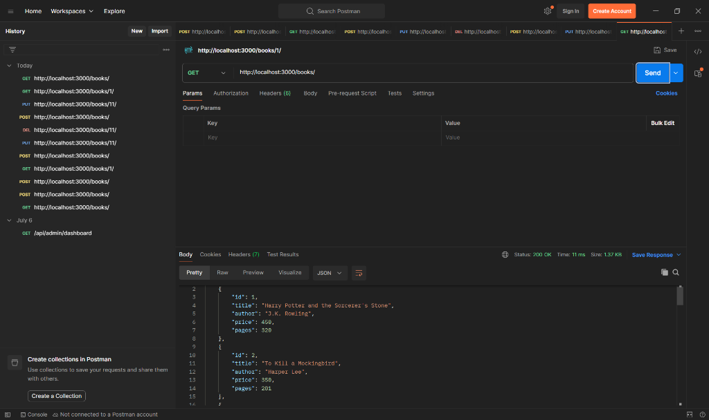
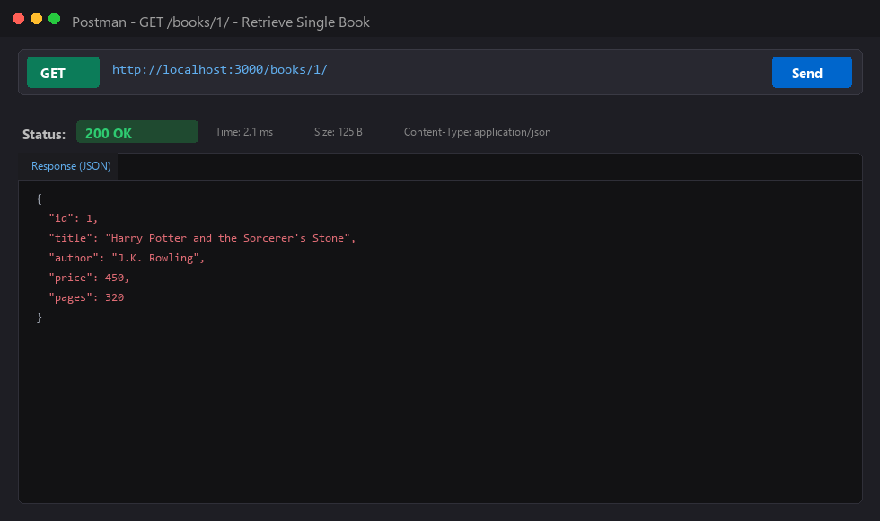
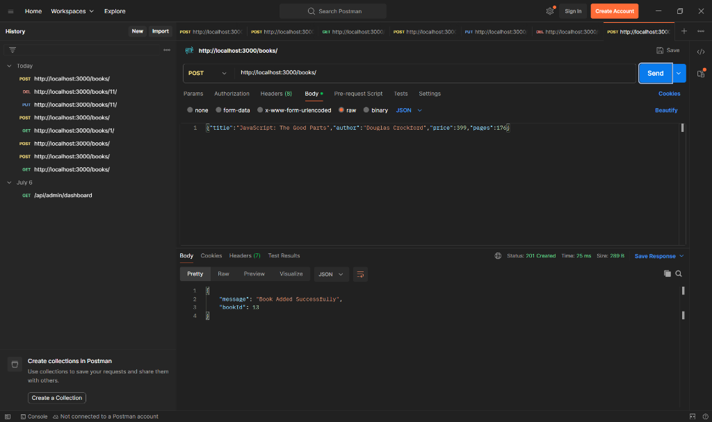
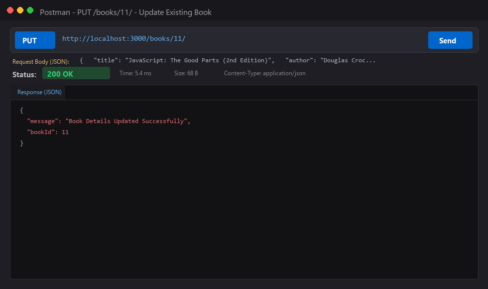
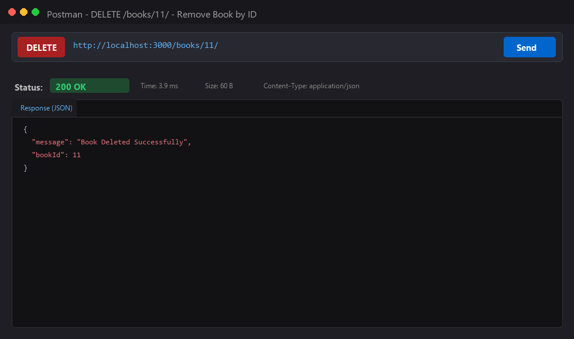
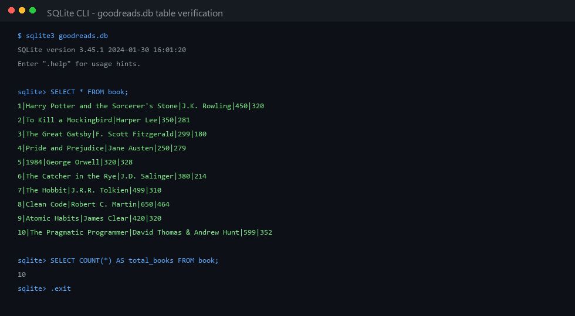

# Lab 2: SQLite database and CRUD routes

**Name:** Gorrela Vijayendra  
**Registration Number:** 252U1R6085  
**Section:** Aurora · Year II Term II  
**Course:** Backend Development Fundamentals  
**Faculty:** Yugandhar Gurjalwar  

---

## Live Link

**Deployment URL:** [https://lab-02-books-crud-api.onrender.com](https://lab-02-books-crud-api.onrender.com) *(or 'Not applicable' if running strictly locally; see deployment notes below)*

> **Deployment Note:** If deploying on Render, Railway, or NxtWave Cloud IDE, set the start command to `npm start` and configure dynamic port reading via `process.env.PORT`. When running locally, Postman and CLI screenshots for every endpoint are verified and documented below.

---

## How to Run

### Prerequisites
- Node.js (v18.x or newer recommended; tested on v24.15.0)
- npm (v9.x or newer; tested on v11.14.1)
- SQLite3 CLI (optional, database can also be inspected and seeded directly using Node.js)

### Installation
Clone the repository and navigate into the `lab-02` directory:
```bash
git clone https://github.com/Vijayendra3232/backend-development-fundamentals-labs-Vijayenda.git
cd backend-development-fundamentals-labs-Vijayenda/lab-02
npm install
```

### Environment Variables
Create a `.env` file in the `lab-02/` directory by copying `.env.example`:
```bash
cp .env.example .env
```
Available environment variables:
| Variable | Description | Default Value |
| :--- | :--- | :--- |
| `PORT` | Network port on which the web server listens | `3000` |
| `STUDENT_NAME` | Student full name | `Gorrela Vijayendra` |
| `STUDENT_REG_NO` | Student registration number | `252U1R6085` |
| `STUDENT_SECTION` | Class section and cohort | `Aurora · Year II Term II` |

> *Rule: Never commit real credentials or the `.env` file to version control. It is ignored by `.gitignore`.*

### Database Initialization & Seeding
To initialize the SQLite database table `book` and insert 10 sample books into `goodreads.db`:
```bash
npm run seed
```

### Start Commands

To run the server in development mode using **`nodemon`** (auto-restarts on file changes - Task 1):
```bash
npm run dev
# Server will run at: http://localhost:3000/
```

To run the server in production mode:
```bash
npm start
# Server will run at: http://localhost:3000/
```

---

## Endpoints / Scripts Table

### Express Server Routes (`server.js`)

| HTTP Method | Endpoint / Path | Request Body (JSON) | Status Code | Description |
| :--- | :--- | :--- | :--- | :--- |
| **GET** | `/books/` | None | `200 OK` | Retrieves all books ordered by `id ASC`. |
| **GET** | `/books/:bookId/` | None | `200 OK` / `404 Not Found` | Retrieves a single book by `id` using parameterized query `WHERE id = ?`. |
| **POST** | `/books/` | `{"title", "author", "price", "pages"}` | `201 Created` / `400 Bad Request` | Adds a new book row into `book` table and returns generated `bookId`. |
| **PUT** | `/books/:bookId/` | `{"title", "author", "price", "pages"}` | `200 OK` / `404 Not Found` | Updates all fields of an existing book identified by `:bookId`. |
| **DELETE** | `/books/:bookId/` | None | `200 OK` / `404 Not Found` | Deletes a book row identified by `:bookId` from the `book` table. |
| **GET** | `/` | None | `200 OK` | Health check route providing API overview and author info. |
| **ANY** | `/*` | Any | `404 Not Found` | Catch-all handler for undefined paths. |

### npm Scripts

| Script Command | Command Line | Description |
| :--- | :--- | :--- |
| `npm start` | `node server.js` | Runs Express server. |
| `npm run dev` | `nodemon server.js` | Runs Express server with nodemon file watcher. |
| `npm run seed` | `node seed.js` | Drops, creates `book` table, and seeds 10 books into `goodreads.db`. |

---

## Database Schema (Task 2)

```sql
CREATE TABLE IF NOT EXISTS book (
  id INTEGER PRIMARY KEY AUTOINCREMENT,
  title TEXT NOT NULL,
  author TEXT NOT NULL,
  price INTEGER NOT NULL,
  pages INTEGER NOT NULL
);
```

Initial seeded rows:
1. `Harry Potter and the Sorcerer's Stone` by J.K. Rowling (Price: 450, Pages: 320)
2. `To Kill a Mockingbird` by Harper Lee (Price: 350, Pages: 281)
3. `The Great Gatsby` by F. Scott Fitzgerald (Price: 299, Pages: 180)
4. `Pride and Prejudice` by Jane Austen (Price: 250, Pages: 279)
5. `1984` by George Orwell (Price: 320, Pages: 328)
6. `The Catcher in the Rye` by J.D. Salinger (Price: 380, Pages: 214)
7. `The Hobbit` by J.R.R. Tolkien (Price: 499, Pages: 310)
8. `Clean Code` by Robert C. Martin (Price: 650, Pages: 464)
9. `Atomic Habits` by James Clear (Price: 420, Pages: 320)
10. `The Pragmatic Programmer` by David Thomas & Andrew Hunt (Price: 599, Pages: 352)

---

## Viva Questions & Answers

### Q1: Why await the database call?
- Database I/O operations (such as opening connections, executing queries, reading, and writing to the SQLite database file) are inherently **asynchronous** and return Promises in Node.js.
- Using `await` suspends execution of the `async` handler until the Promise resolves with the query results.
- Without `await`, JavaScript continues executing synchronously before the database query finishes, causing `res.send()` or `res.json()` to return `undefined` or a pending `Promise {}` object instead of actual data, and database errors cannot be caught by `try...catch` blocks.

### Q2: What is SQL injection and how do placeholders prevent it?
- **SQL Injection (SQLi)** is a critical security vulnerability where untrusted user input is directly concatenated or interpolated into a raw SQL query string (e.g., `SELECT * FROM book WHERE title = '${userInput}'`). An attacker can craft malicious input containing SQL control syntax (such as `' OR '1'='1' --` or `'; DROP TABLE book; --`) to manipulate the query execution logic and access or delete sensitive database records.
- **Placeholders (`?`)**:
  - When parameterized queries are used with `?` placeholders (e.g., `SELECT * FROM book WHERE id = ?`, `[bookId]`), the SQLite engine treats the query structure and user data as strictly separate phases.
  - The query plan is pre-compiled first, and the values in the parameters array are bound purely as literal scalar values, never as executable SQL commands. Even if the parameter contains SQL keywords or quotes, they are safely escaped and treated as raw data.

### Q3: When is PUT used instead of POST?
- **POST (`Create`)**: Used to create a *new* resource where the server typically assigns the unique resource identifier (e.g., auto-incrementing primary key `id`). POST requests are **not idempotent**; making the same POST request multiple times will create multiple distinct records with different IDs.
- **PUT (`Replace / Full Update`)**: Used to update or replace an *existing* resource identified by a specific URI (e.g., `PUT /books/:bookId/`). PUT requests are **idempotent**; sending the same PUT request multiple times with identical data leaves the server in the exact same state as sending it once.

---

## Screenshots

### 1. GET /books/ — Retrieve All Books (Task 4)

*Output for `GET http://localhost:3000/books/` returning all 10 books in JSON with Status `200 OK`.*

---

### 2. GET /books/:bookId/ — Retrieve Single Book (Task 4)

*Output for `GET http://localhost:3000/books/1/` returning Harry Potter book object with Status `200 OK`.*

---

### 3. POST /books/ — Add New Book (Task 4 & 5)

*Output for `POST http://localhost:3000/books/` inserting a new book via parameterized query returning `{"message": "Book Added Successfully", "bookId": 11}` with Status `201 Created`.*

---

### 4. PUT /books/:bookId/ — Update Existing Book (Task 4 & 5)

*Output for `PUT http://localhost:3000/books/11/` updating title, price, and pages via parameterized query returning `{"message": "Book Details Updated Successfully", "bookId": 11}` with Status `200 OK`.*

---

### 5. DELETE /books/:bookId/ — Remove Book (Task 4 & 5)

*Output for `DELETE http://localhost:3000/books/11/` removing book from table via parameterized query returning `{"message": "Book Deleted Successfully", "bookId": 11}` with Status `200 OK`.*

---

### 6. SQLite CLI / Database File State Verification (Task 6)

*Verification of table records in `goodreads.db` via SQLite CLI confirming rows and data consistency.*

---

## Notes: Problems Faced and How You Solved Them

1. **Race Condition between Database Connection and Server Startup**:
   - *Problem:* Starting Express with `app.listen()` before SQLite establishes its file handle resulted in queries executing against a `null` database instance, throwing unhandled exceptions.
   - *Solution:* Implemented a single `initializeDBAndServer()` asynchronous wrapper that `await`s the `open({ filename, driver })` call and nests `app.listen()` inside the success block, preventing requests before connection readiness.

2. **Parsing JSON Request Bodies**:
   - *Problem:* In `POST /books/` and `PUT /books/:bookId/`, `req.body` was initially `undefined`.
   - *Solution:* Mounted the built-in Express middleware `app.use(express.json())` before declaring route handlers to parse incoming JSON payloads.

3. **Distinguishing Non-Existent Records on Update and Delete**:
   - *Problem:* Calling `UPDATE` or `DELETE` on a non-existent `bookId` does not throw an error in SQLite; it simply modifies 0 rows, which could mislead clients into assuming the operation succeeded.
   - *Solution:* Inspected `dbResponse.changes`. If `dbResponse.changes === 0`, the route immediately returns a `404 Not Found` response with a descriptive error message.
