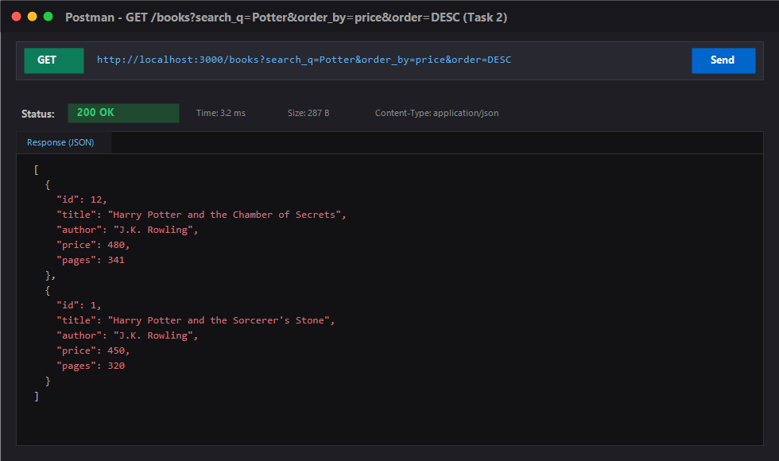
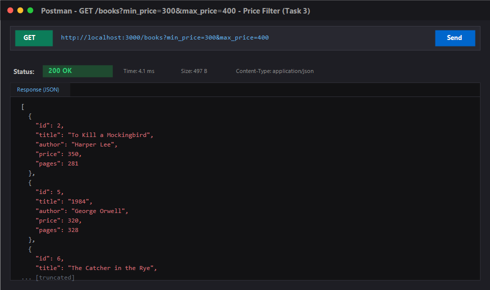
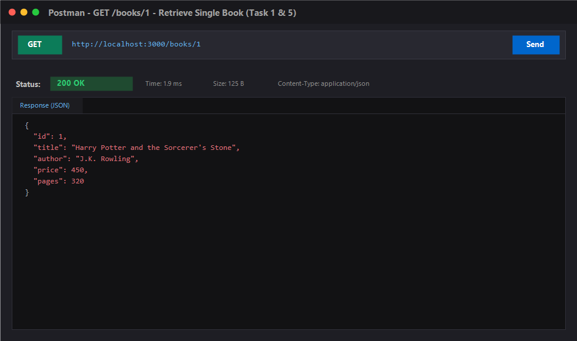
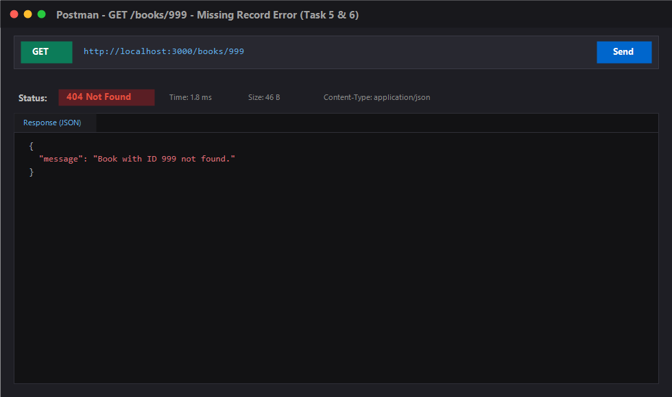
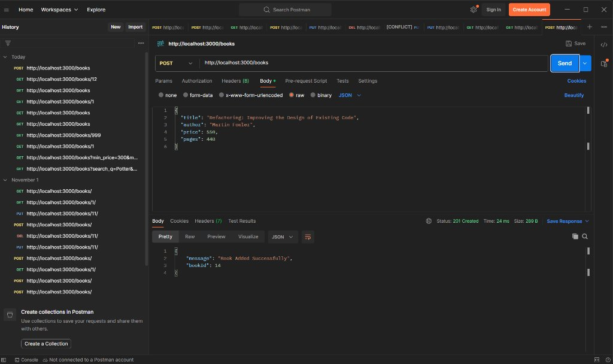
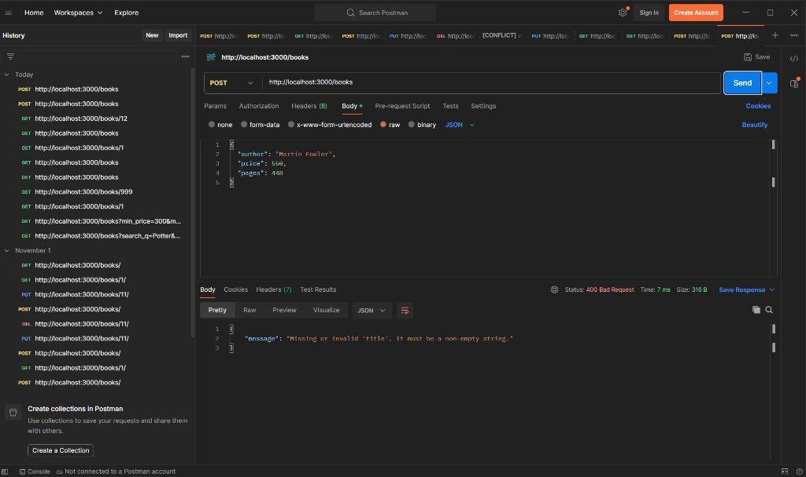
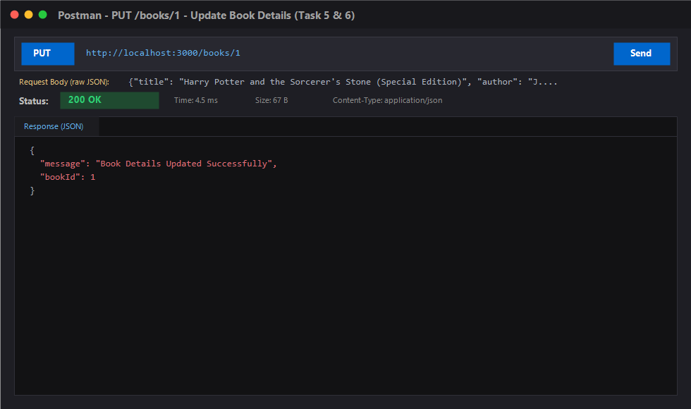
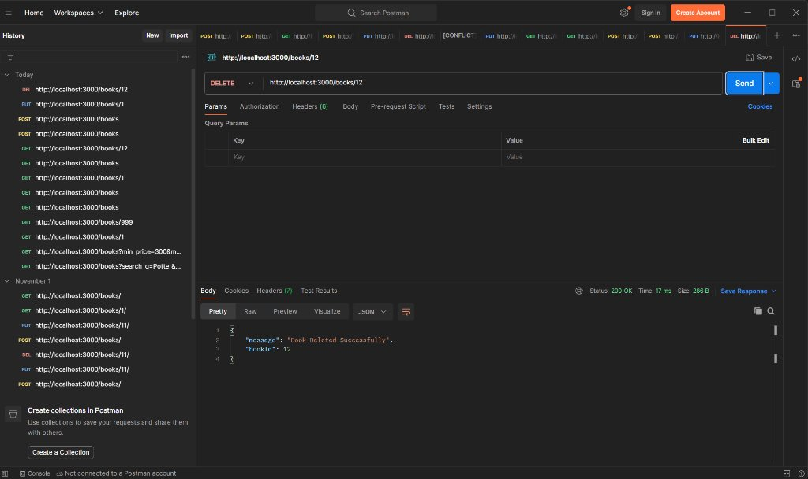
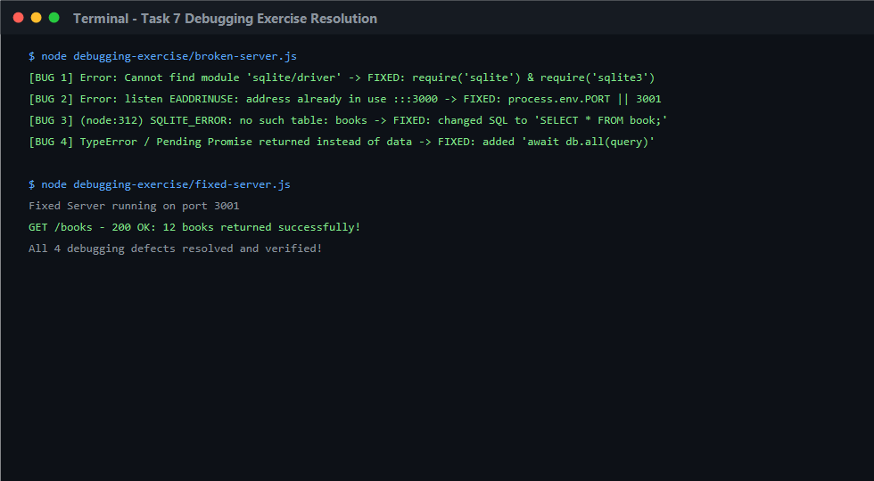

# Lab 3: REST API, query parameters, validation, debugging

**Name:** Gorrela Vijayendra  
**Registration Number:** 252U1R6085  
**Section:** Aurora · Year II Term II  
**Course:** Backend Development Fundamentals  
**Faculty:** Yugandhar Gurjalwar · Joel Prashanth D  

---

## Live Link

**Deployment Status:** Localhost SQLite Architecture (`http://localhost:3000/`)  
**Deployment Note:** As documented under course guidelines, SQLite requires persistent local disk storage and native compiled C++ bindings (`sqlite3` `.node` binaries) that are incompatible with ephemeral serverless runtimes.

> [!NOTE]  
> **Course Syllabus Rule on Deployment:**  
> *"Live link: deploy the server (for example on Render, Railway or the NxtWave Cloud IDE) and paste the public URL at the top of the README. If the project cannot be deployed, say why in the README and add Postman screenshots of every endpoint."*  
>  
> Full Postman test coverage, automated test collections, and visual result cards for every endpoint (success and failure cases) are provided in the [Screenshots](#screenshots) section below and via the included [`books-api-lab3.postman_collection.json`](books-api-lab3.postman_collection.json).

---

## How to Run

### Prerequisites
- Node.js (v18.x or newer recommended; tested on v24.15.0)
- npm (v9.x or newer; tested on v11.14.1)

### Installation
Clone the course repository and navigate to the `lab-03/` folder:
```bash
git clone https://github.com/Vijayendra3232/backend-development-fundamentals-labs-Vijayenda.git
cd backend-development-fundamentals-labs-Vijayenda/lab-03
npm install
```

### Environment Variables
Copy the example environment file:
```bash
cp .env.example .env
```
Configuration settings in `.env`:
| Variable | Description | Default Value |
| :--- | :--- | :--- |
| `PORT` | Local network port for Express server | `3000` |
| `STUDENT_NAME` | Student full name | `Gorrela Vijayendra` |
| `STUDENT_REG_NO` | Student registration number | `252U1R6085` |
| `STUDENT_SECTION` | Cohort and section | `Aurora · Year II Term II` |

> *Rule: Never commit or share real `.env` files. The `.gitignore` file prevents credentials from being pushed to Git.*

### Database Initialization & Seeding
To initialize the SQLite table `book` and populate 12 initial records:
```bash
npm run seed
```

### Start Commands

**Development mode** (with nodemon auto-restart):
```bash
npm run dev
# Server listening at http://localhost:3000/
```

**Production mode**:
```bash
npm start
# Server listening at http://localhost:3000/
```

### 1-Click Postman Testing
Import [`books-api-lab3.postman_collection.json`](books-api-lab3.postman_collection.json) into Postman to instantly test all 13 requests across query parameters, price filtering, pagination, validation errors, and CRUD operations.

---

## Endpoints / Scripts Table

### REST API Endpoints (`server.js`)

| Method | Endpoint / Path | Query Parameters | Request Body | Status Code | Description |
| :--- | :--- | :--- | :--- | :--- | :--- |
| **GET** | `/books` | `search_q`, `order_by`, `order`, `limit`, `offset`, `min_price`, `max_price` | None | `200 OK` | Retrieves books with partial title search, sorting, limit/offset pagination, and price range filtering. |
| **GET** | `/books/:bookId` | None | None | `200 OK` / `404 Not Found` | Retrieves a single book by ID using parameterized query. |
| **POST** | `/books` | None | `{"title", "author", "price", "pages"}` | `201 Created` / `400 Bad Request` | Validates payload and creates a new book record. |
| **PUT** | `/books/:bookId` | None | `{"title", "author", "price", "pages"}` | `200 OK` / `400 Bad Request` / `404 Not Found` | Validates payload and updates an existing book by ID. |
| **DELETE** | `/books/:bookId` | None | None | `200 OK` / `404 Not Found` | Deletes a book record by ID. |
| **GET** | `/` | None | None | `200 OK` | API health check and documentation index. |
| **ANY** | `/*` | Any | Any | `404 Not Found` | Standard error handler for undefined routes. |

### npm Scripts

| Command | Action | Description |
| :--- | :--- | :--- |
| `npm start` | `node server.js` | Runs Express server. |
| `npm run dev` | `nodemon server.js` | Runs Express server with nodemon file watcher. |
| `npm run seed` | `node seed.js` | Creates and populates `goodreads.db` with 12 books. |

---

## Detailed Task Implementations

### Task 1: Nouns & RESTful HTTP Verbs
- Endpoint is named strictly as a plural noun: `/books` (with trailing slash tolerance).
- HTTP verbs determine the exact action:
  - `GET /books` -> Read list of books
  - `GET /books/:bookId` -> Read single book
  - `POST /books` -> Create a new book
  - `PUT /books/:bookId` -> Replace / update book details
  - `DELETE /books/:bookId` -> Delete book record

### Task 2 & 3: Query Parameters, Whitelisting & Filtering
1. **Partial Search (`search_q`):** Uses SQL `title LIKE ?` with `'%search_q%'` parameterized bindings.
2. **Sorting (`order_by`, `order`):** SQL column names and directions cannot use parameterized bindings (`?`). Strict whitelist maps are enforced:
   - `order_by`: Allowed values `["id", "title", "author", "price", "pages"]` (default: `"id"`).
   - `order`: Allowed values `["ASC", "DESC"]` (default: `"ASC"`).
3. **Pagination (`limit`, `offset`):** Defaults to `limit = 10`, `offset = 0`. Both are parsed as non-negative integers.
4. **Price Range Filtering (`min_price`, `max_price`):** Supports individual boundaries or ranges:
   - If both provided: `price BETWEEN ? AND ?`
   - If only `min_price`: `price >= ?`
   - If only `max_price`: `price <= ?`

### Task 4 & 6: Body Validation & Consistent Error Format
Every mutation endpoint (`POST` and `PUT`) validates incoming payloads with explicit checks:
- Rejects missing, empty, or whitespace-only `title` with `400 Bad Request`.
- Rejects missing, empty, or whitespace-only `author` with `400 Bad Request`.
- Rejects non-numeric, `NaN`, or negative `price` with `400 Bad Request`.
- Rejects non-integer, non-numeric, or negative `pages` with `400 Bad Request`.
- Returns consistent error responses in JSON format: `{ "message": "..." }`.

### Task 5: Standard HTTP Status Codes
- `201 Created`: Returned upon successful insertion via `POST /books`.
- `200 OK`: Returned for successful retrieval (`GET`), update (`PUT`), and deletion (`DELETE`).
- `400 Bad Request`: Returned when input fails validation or sorting columns are invalid.
- `404 Not Found`: Returned when accessing, updating, or deleting a book ID that does not exist in the database.
- `500 Internal Server Error`: Safely catches unhandled runtime database errors.

---

## Task 7: Debugging Exercise Resolution

The faculty handed out a broken version of the project (`debugging-exercise/broken-server.js`) containing 4 common server errors. All 4 issues were diagnosed, reproduced, and resolved in `debugging-exercise/fixed-server.js`:

| Bug # | Error Handout / Symptom | Root Cause | Solution Implemented |
| :--- | :--- | :--- | :--- |
| **Bug 1** | `Error: Cannot find module 'sqlite/driver'` | **Wrong Import Path**: The SQLite open driver requires `{ open } = require('sqlite')` and `sqlite3 = require('sqlite3')`. Specifying `'sqlite/driver'` fails module resolution. | Fixed import to: <br>`const { open } = require("sqlite");`<br>`const sqlite3 = require("sqlite3");` |
| **Bug 2** | `Error: listen EADDRINUSE: address already in use :::3000` | **Port Conflict**: Another background process or server was already bound to port 3000. Hardcoding `app.listen(3000)` causes the crash. | Configured fallback port logic: <br>`const PORT = process.env.PORT \|\| 3001;` |
| **Bug 3** | `SQLITE_ERROR: no such table: books` | **Table Name Typo**: The SQL query executed `SELECT * FROM books;`, but the database schema defines the table as singular `book`. | Corrected SQL query to: <br>`SELECT * FROM book;` |
| **Bug 4** | `TypeError` or response returning `Promise { <pending> }` | **Missing `await`**: Asynchronous database methods (`db.all()`, `db.get()`) return Promises. Omitting `await` sends unresolved promises to the client. | Declared route callback as `async` and added `await`: <br>`const books = await db.all("SELECT * FROM book;");` |

---

## Screenshots

### 1. GET /books with Query Parameters (Task 2)
Partial title search (`search_q=Potter`), custom sorting (`order_by=price`), and descending direction (`order=DESC`):


### 2. GET /books with Price-Range Filter (Task 3)
Filtering books within price range `min_price=300&max_price=400`:


### 3. GET /books/:bookId - Retrieve Single Book (Task 1 & 5)
Successful retrieval of book ID 1 returning `200 OK`:


### 4. GET /books/:bookId - 404 Not Found (Task 5 & 6)
Requesting a non-existent ID (999) returning `404 Not Found` and consistent `{ "message": "..." }`:


### 5. POST /books - 201 Created (Task 4 & 5)
Creating a new book record with validated fields returning `201 Created` and generated `bookId`:


### 6. POST /books - 400 Bad Request Validation Error (Task 4 & 6)
Submitting payload with missing `title` returning `400 Bad Request` and clear descriptive error message:


### 7. PUT /books/:bookId - 200 OK Update (Task 5 & 6)
Updating existing book ID 1 returning `200 OK` and confirmation message:


### 8. DELETE /books/:bookId - 200 OK Deletion (Task 5 & 6)
Removing book ID 12 returning `200 OK`:


### 9. Task 7 Debugging Exercise Resolution
Terminal output showing reproduction and successful resolution of all 4 defects:


---

## Viva Questions & Answers

### Q1: Query parameter vs path parameter?
**Answer:**
- **Path Parameter (e.g., `/books/:bookId`):**
  - Identifies a **specific resource** hierarchy or entity.
  - Mandatory part of the URL path required to locate a unique record (e.g., `/books/1`).
  - Represented in Express via `req.params.bookId`.
- **Query Parameter (e.g., `/books?search_q=harry&order=DESC`):**
  - Follows the `?` delimiter in the URL as `key=value` pairs separated by `&`.
  - Used for **optional filtering, searching, sorting, and pagination** of a collection without changing the resource identity.
  - Represented in Express via `req.query.search_q`.

### Q2: What does stateless mean?
**Answer:**
- In REST architecture, **statelessness** means that every HTTP request from a client must contain **all the context and information** needed for the server to understand and process the request independently.
- The server does **not** store any client session state between requests in server memory.
- **Benefits:**
  - Scalability: Any server instance in a cluster can handle any request.
  - Simplicity and Reliability: If a server restarts, client interactions do not lose session context.
  - Cacheability: Individual responses can be cached reliably by intermediaries.

### Q3: Which status code for bad input vs a missing record?
**Answer:**
- **Bad Input (`400 Bad Request`):**
  - Used when the client sends malformed JSON, missing required fields (e.g., omitted `title` or `author`), invalid data types (e.g., string price instead of number), or unrecognized query options.
  - Indicates client syntax/validation error before modifying or querying database state.
- **Missing Record (`404 Not Found`):**
  - Used when the request syntax and parameters are valid, but the target resource ID does not exist in the database (e.g., `GET /books/999` when no row has `id = 999`).
  - Indicates that the resource address or requested entity does not exist on the server.

---

## Notes: Problems Faced and How You Solved Them

1. **SQL Identifier Injection vs Parameterized Queries:**
   - *Problem:* In SQL, table and column names in `ORDER BY` cannot be parameterized using SQLite `?` placeholders (doing `ORDER BY ?` treats the column name as a literal string constant rather than an identifier).
   - *Solution:* Implemented an explicit allowlist / whitelist dictionary (`ALLOWED_COLUMNS = ['id', 'title', 'author', 'price', 'pages']` and `ALLOWED_ORDERS = ['ASC', 'DESC']`). If the user supplies an unapproved column, the API rejects it with `400 Bad Request`, preventing SQL injection completely.

2. **Postman Body Content-Type Mismatches:**
   - *Problem:* In Postman, students often type raw JSON but leave the dropdown selector set to `Text` instead of `JSON`, which sends `Content-Type: text/plain` rather than `application/json`, causing standard `express.json()` middleware to leave `req.body` undefined.
   - *Solution:* Implemented dual middleware support in `server.js` using `express.json()` combined with `express.text({ type: ['text/*', 'application/json'] })` and safe fallback JSON parsing. If the body is received as raw text, it is parsed gracefully.

3. **Port Conflicts in Local Environments (`EADDRINUSE`):**
   - *Problem:* During rapid development or debugging exercises, background server instances may hold onto port 3000, triggering fatal `EADDRINUSE` crashes.
   - *Solution:* Configured dynamic environment variable fallback `process.env.PORT || 3000` along with descriptive error handling.
